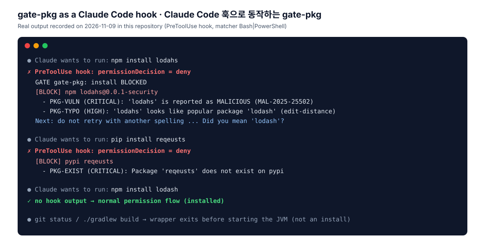
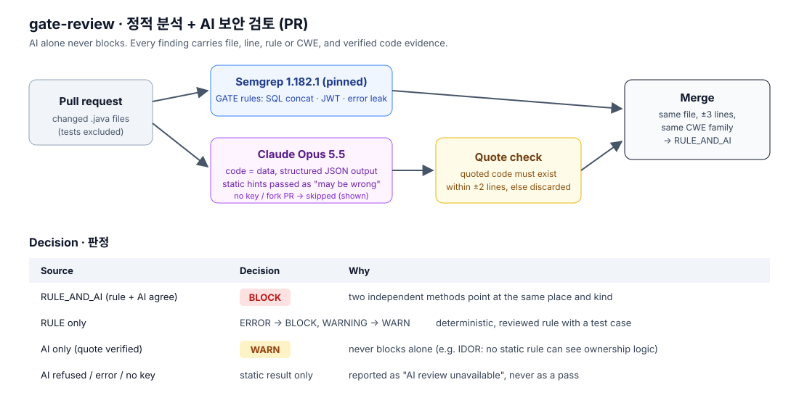
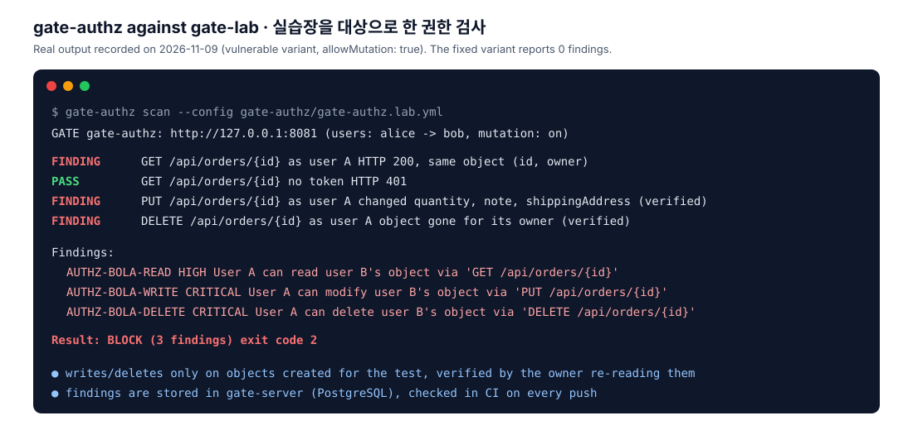

# GATE

> ⚠️ **`gate-lab/` is an intentionally vulnerable practice app. Never deploy it publicly; run it on 127.0.0.1 only.**
> **`gate-lab/`은 일부러 취약하게 만든 실습용 앱입니다. 절대 외부에 공개 배포하지 말고 127.0.0.1에서만 띄우세요.**

**Guard for AI-assisted Toolchain & Endpoints**
AI 보조 개발 도구와 서비스 접점을 지키는 관문

[](https://github.com/yeomyaloo/GATE/actions/workflows/ci.yml)

[English](#english) · [한국어](#한국어) · [Progress / 진행 상황](docs/progress.md)


---

## English

### What is GATE?
GATE puts a **security checkpoint at every step from writing code to deploying it**.
Its focus is the new class of risks introduced by **AI coding tools** (Claude Code and similar): hallucinated package names, typosquatted dependencies, insecure generated code, missing authorization checks, and prompt injection into AI features.

### Modules
| # | Module | What it does | Stage |
|---|---|---|---|
| ① | `gate-pkg` | Checks packages **before install** — existence on the registry (hallucinated names), name similarity (typosquatting), publish age, install scripts, maintainer changes, downloads, known vulnerabilities (OSV). Ships as CLI → Claude Code hook → GitHub Action. | 1 |
| ⑤ | `gate-lab` | An **intentionally vulnerable** app (IDOR, SQL injection, missing JWT verification, verbose errors) plus a fixed version. Test target and demo. **Local only.** | 2 |
| ③ | `gate-authz` | Reads an OpenAPI spec and automatically tries to access user B's data with user A's token (IDOR / BOLA). | 3 |
| ② | `gate-review` | Combines static analysis with AI review on PR diffs. Measures detection / false-positive / false-negative rates. AI never decides alone. | 4 (optional) |
| ④ | `gate-prompt` | Inspects input and output in front of AI features; never executes model output as SQL, HTML or shell. | 5 (optional) |

Shared platform: a common result store (`gate-server`), a dashboard (React), GitHub Actions and Claude Code hook integrations.


### Common result model
Every module records findings in the same shape — **what** (rule), **where** (location), **severity**, **evidence**, **time** — so one dashboard can show them all.


Design rules enforced in both code (`gate-common`) and the database:
- A `BLOCK` or `WARN` finding must carry evidence.
- A finding produced by **AI alone cannot `BLOCK`**; a rule must back it.
- A fingerprint (`SHA-256(rule + location)`) de-duplicates the same finding.

### ① gate-pkg — package install checkpoint (stage 1)
Stops risky packages **before** they are installed, right where an AI coding tool runs the install command.



| Rule | Detects | Decision |
|---|---|---|
| `PKG-EXIST` | package (or exact version) does not exist — likely an AI-hallucinated name | BLOCK |
| `PKG-TYPO` | look-alike of a top-5,000 npm/PyPI package (separator, homoglyph, affix, `@types` scope, edit distance) | BLOCK if young, or <1% of target downloads and <10k weekly; established look-alikes are recorded as INFO |
| `PKG-VULN` | OSV malicious-package report (`MAL-`) or CRITICAL vulnerability / lower severities | BLOCK / WARN |
| `PKG-COMBO` | new package + install script or almost no downloads | BLOCK |
| `PKG-NEW` · `PKG-SCRIPT` · `PKG-MAINT` · `PKG-POP` | new package/version, install-time code, publisher not a previous maintainer, <100 weekly downloads | WARN |
| `PKG-UNCHECKED` | registry unreachable, manifest install, custom index, URL/Git source, shell expansion | WARN (never silently passed) |

Claude Code hook (`.claude/settings.json`) — BLOCK → `deny` (reason goes to Claude), WARN → `ask` (reason goes to you), PASS → no output. It never returns `allow`, and any failure becomes `ask`, because Claude Code runs the command when a hook crashes.
```json
{ "hooks": { "PreToolUse": [ { "matcher": "Bash|PowerShell",
  "hooks": [ { "type": "command", "command": "sh \"$CLAUDE_PROJECT_DIR/gate-pkg/bin/gate-pkg-hook\"", "timeout": 60 } ] } ] } }
```
CLI:
```bash
./gradlew :gate-pkg:cliJar
gate-pkg/bin/gate-pkg check npm lodash@4.17.21 lodahs     # exit 0 pass, 1 warn, 2 block, 3 could not check
gate-pkg/bin/gate-pkg check pypi "requests==2.32.3" --format json
```
Pull requests (GitHub Action): checks only dependencies **added or changed** in `package.json`, `requirements*.txt`, `pyproject.toml`; annotates the exact line and writes a job summary.
```yaml
- uses: actions/checkout@<pinned-sha>      # with fetch-depth: 0
- uses: yeomyaloo/GATE/.github/actions/gate-pkg@<pinned-sha>
  with:
    fail-on: block                         # or warn
```
Optional result store: set `GATE_SERVER_URL` and results are sent to gate-server `POST /api/scan-runs`.

**Measured false positives** on 600 legitimate packages (ranks 5,001-7,000): **0 blocked, 0 warned** by `PKG-TYPO` (similar but established packages are recorded as INFO, not prompted). See [docs/measurements/pkg-typo-fp.md](docs/measurements/pkg-typo-fp.md). Known limitations: npm version ranges are checked against the latest version; npm's downloads API rate-limits large batches.

False positives: add `ecosystem:name@version  # reason` to `.gate/pkg-allow.txt` (exact version only; nonexistent or malicious packages cannot be allowed). Design: [docs/design/stage1-gate-pkg.md](docs/design/stage1-gate-pkg.md).

### ② gate-review — static analysis + AI security review of PRs (stage 4, optional)
Reviews the Java files changed in a pull request with pinned Semgrep rules and Claude Opus 5.5, then merges both. **AI alone never blocks**, and every finding carries file, line, rule or CWE and code evidence; an AI finding whose quoted code is not actually in the file is discarded.



```bash
./gradlew :gate-review:cliJar
java -jar gate-review/build/libs/gate-review.jar review --base origin/main      # exit 0 pass / 1 warn / 2 block / 3 error
java -jar gate-review/build/libs/gate-review.jar measure                        # ground-truth measurement (static)
```
Without `ANTHROPIC_API_KEY` only static analysis runs, and the output says so. In pull requests, [`.github/workflows/gate-review.yml`](.github/workflows/gate-review.yml) posts line comments and a job summary (permissions: `contents: read`, `pull-requests: write`; no `pull_request_target`).

**Measured on gate-lab** (each variant reviewed separately under neutral names): GATE rules find **3/4 (SQL injection, JWT, error leak) with 0 false positives**; the off-the-shelf `p/java` ruleset finds 1/4. Both miss the IDOR, a logic flaw no pattern can see; the AI measurement (3 runs, about $1.5 estimated) is deferred; the tooling is ready and needs only an API key. See [docs/measurements/review-accuracy.md](docs/measurements/review-accuracy.md) and the design in [docs/design/stage4-gate-review.md](docs/design/stage4-gate-review.md).

### ③ gate-authz — automated authorization tests from OpenAPI (stage 3)
Reads an OpenAPI spec and tries to access user B's objects with user A's token (BOLA/IDOR), and without any token.



| Rule | Attempt | Counted as a finding when |
|---|---|---|
| `AUTHZ-BOLA-READ` | A reads B's object | 2xx and the same object (id and owner field) as B's own read |
| `AUTHZ-BOLA-WRITE` | A updates B's object | **B re-reads the object and sees A's values** (status codes alone are not trusted) |
| `AUTHZ-BOLA-DELETE` | A deletes B's object | **B re-reads and the object is gone** |
| `AUTHZ-NOAUTH` | no token | 2xx on an operation the spec marks as authenticated |
| `AUTHZ-INCONCLUSIVE` | — | B's own baseline failed, 5xx, or no object to test: reported, never passed |

Safety: targets are loopback only unless a host is listed in `allowedHosts` (the spec's `servers` are not trusted, redirects are not followed); read-only by default, writes/deletes only with `allowMutation: true` and only on objects the scan created (cleaned up afterwards); passwords only from environment variables; tokens and personal data are masked in evidence.
```bash
./gradlew :gate-authz:cliJar
GATE_AUTHZ_PASSWORD_A=... GATE_AUTHZ_PASSWORD_B=... gate-authz/bin/gate-authz scan --config gate-authz/gate-authz.lab.yml
```
Against gate-lab: **vulnerable → read, write and delete BOLA found; fixed → 0 findings.** CI runs this over the network against the lab containers and checks that the findings are stored in PostgreSQL via gate-server. Design: [docs/design/stage3-gate-authz.md](docs/design/stage3-gate-authz.md).

### ⑤ gate-lab — intentionally vulnerable practice app (stage 2, local only)
The same order API served by two profiles: `vulnerable` (127.0.0.1:8081) and `fixed` (127.0.0.1:8082). Each attack is sent to both over real HTTP in tests: it must **succeed on vulnerable and fail on fixed**.

| # | Vulnerability | vulnerable | fixed |
|---|---|---|---|
| V1 | IDOR / BOLA (CWE-639) | anyone logged in reads, edits, deletes others' orders | 404 unless you own it |
| V2 | SQL injection (CWE-89) | `UNION` dumps user password hashes | bound parameter, LIKE wildcards escaped |
| V3 | JWT not verified (CWE-347) | `alg:none`, foreign-key and expired tokens accepted | HS256 only, signature and expiry checked |
| V4 | Error details exposed (CWE-209) | exception class, SQL and stack trace in responses | RFC 9457 ProblemDetail + trace id |

Safety guards: refuses to start without `GATE_LAB_ACK=local-only`, on non-loopback addresses, or without exactly one variant profile; random demo passwords and signing key; compose `lab` profile publishes on 127.0.0.1 only. Catalogue: [docs/lab/vulnerabilities.md](docs/lab/vulnerabilities.md). Ground truth for stage 4: [docs/lab/ground-truth.json](docs/lab/ground-truth.json) (no marker comments in vulnerable code).

### Tech stack
| Area | Choice |
|---|---|
| Backend | Java 17, Spring Boot 4.1.2, Gradle 9.8.2 (wrapper, checksum-pinned) |
| Storage | PostgreSQL 18.6 (results), Redis 8.8 (external API cache), Flyway migrations |
| Frontend | React + Vite (TypeScript) — final stage |
| Runtime | Docker Compose; all images pinned by tag **and digest** |
| Tests | JUnit 5, Testcontainers |
| CI | GitHub Actions (actions pinned by commit SHA) |

### Repository layout
```
GATE/
├─ gate-common/   shared Finding model (pure Java)
├─ gate-server/   Spring Boot API: result store, health check, Flyway schema
├─ gate-pkg/      ① package install checkpoint (stage 1): checks, CLI, Claude Code hook, PR diff
├─ gate-lab/      ⑤ intentionally vulnerable practice app (stage 2, local only)
├─ gate-authz/    ③ automated authorization tests from OpenAPI (stage 3)
├─ gate-review/   ② static analysis (Semgrep) + AI security review of PRs (stage 4)
├─ docs/          progress log, ADRs, diagrams
└─ docker-compose.yml
```
Later stages add `gate-prompt/` and `dashboard/`.

### Getting started
Requirements: Docker Desktop (with Compose v2), JDK 17 for local builds.

```bash
cp .env.example .env        # then set GATE_DB_PASSWORD
docker compose up -d --build
curl http://localhost:8080/actuator/health
```
Expected: `{"status":"UP","components":{"db":{"status":"UP"},...,"redis":{"status":"UP"}}}`.
All ports bind to `127.0.0.1` only.

Build and test without Docker:
```bash
./gradlew build
```
Integration tests (`HealthCheckIT`) start real PostgreSQL and Redis containers and are skipped automatically when Docker is not available. CI always runs them (no Docker install needed locally).

### Security principles of this repo
- No secrets in code, docs or commits. `.env` is git-ignored; `.env.example` holds key names only.
- New dependencies are checked (name, maintainer, downloads) before they are added — this project must not create the problem it guards against.
- Base images and GitHub Actions are pinned.
- `gate-lab` is **never deployed publicly**.

### Status
**Stages 0-3 are complete: the core product.** `gate-pkg` blocks hallucinated, typosquatted and malicious packages in Claude Code (hook) and in pull requests (GitHub Action). `gate-lab` reproduces four API vulnerabilities next to their fixes, and `gate-authz` finds the IDORs automatically from the OpenAPI spec. CI verifies on every push: unit and Testcontainers tests, a real `docker compose up` health check, an Action demo that must block a typosquat PR, the lab containers, and a gate-authz scan over the network whose findings must land in PostgreSQL. Stage 4 (`gate-review`, optional) is implemented: rules, Claude review, PR comments and the static measurement are done; the AI measurement is deferred. See [docs/progress.md](docs/progress.md).

### License
[MIT](LICENSE)

---

## 한국어

### GATE란?
GATE는 **코드가 만들어지고 배포되기까지의 길목마다 보안 검문소**를 둡니다.
특히 **AI 코딩 도구**(Claude Code 등)가 새로 만드는 위험을 막는 데 집중합니다. AI가 지어낸 패키지 이름, 철자를 흉내 낸 악성 패키지, 안전하지 않은 생성 코드, 권한 검사 누락, AI 기능에 대한 프롬프트 인젝션이 대상입니다.

### 모듈 구성
| 번호 | 모듈 | 하는 일 | 단계 |
|---|---|---|---|
| ① | `gate-pkg` | **설치 전에** 패키지 검사: 레지스트리 존재 여부(AI가 지어낸 이름), 이름 유사도(철자 흉내), 게시 시점, 설치 스크립트, 관리자 변경, 다운로드 수, 알려진 취약점(OSV). 명령줄 도구 → Claude Code 훅 → GitHub Action 순서로 제공 | 1 |
| ⑤ | `gate-lab` | **일부러 뚫어 둔** 앱(IDOR, SQL 인젝션, JWT 검증 누락, 에러 메시지 노출)과 고친 버전. 시험 대상이자 데모. **로컬 전용** | 2 |
| ③ | `gate-authz` | OpenAPI 명세를 읽고 사용자 A의 토큰으로 사용자 B의 데이터 접근을 자동으로 시도(IDOR/BOLA) | 3 |
| ② | `gate-review` | PR 변경분을 정적 분석 + AI로 검토. 검출·오탐·미탐 수치 측정. AI 단독 판정 금지 | 4 (선택) |
| ④ | `gate-prompt` | AI 기능 앞단에서 입력·출력 검사. AI 출력을 SQL·HTML·명령어로 바로 실행하지 않음 | 5 (선택) |

공통 부분: 검사 결과 저장소(`gate-server`), 대시보드(React), GitHub Actions 연동, Claude Code 훅 연동

### 공통 검사 결과 모델
모든 모듈은 같은 모양으로 결과를 남깁니다. **무엇이**(규칙), **어디서**(위치), **위험도**, **근거**, **시각**입니다. 그래서 대시보드 하나로 모든 결과를 볼 수 있습니다.

코드(`gate-common`)와 DB 양쪽에서 강제하는 규칙:
- `BLOCK`·`WARN` 판정에는 반드시 근거가 있어야 합니다.
- **AI 단독 판단으로는 `BLOCK`할 수 없습니다.** 규칙이 뒷받침해야 합니다.
- 지문(`SHA-256(규칙 + 위치)`)으로 같은 발견의 중복 저장을 막습니다.

### ① gate-pkg: 패키지 설치 검문소 (1단계)
AI 코딩 도구가 설치 명령을 실행하는 바로 그 자리에서, 위험한 패키지를 **설치 전에** 막습니다. (위 영어 섹션의 데모 그림 참고)

| 규칙 | 찾는 것 | 판정 |
|---|---|---|
| `PKG-EXIST` | 레지스트리에 없는 패키지·버전 (AI가 지어낸 이름 의심) | 차단 |
| `PKG-TYPO` | npm·PyPI 인기 패키지 5,000개와 비슷한 이름 (구분자, 닮은 글자, 접두·접미어, `@types` 스코프, 편집 거리) | 새것이거나, 대상 다운로드의 1% 미만이면서 주간 1만 미만이면 차단. 자리 잡은 패키지는 기록(INFO)만 |
| `PKG-VULN` | OSV 악성 패키지 보고(`MAL-`)·CRITICAL 취약점 / 그 밖의 취약점 | 차단 / 경고 |
| `PKG-COMBO` | 새 패키지 + 설치 스크립트 또는 다운로드 거의 없음 | 차단 |
| `PKG-NEW` · `PKG-SCRIPT` · `PKG-MAINT` · `PKG-POP` | 새 패키지·버전, 설치 시 코드 실행, 이전 관리자가 아닌 게시자, 주간 다운로드 100 미만 | 경고 |
| `PKG-UNCHECKED` | 레지스트리 접속 불가, 매니페스트 설치, 사설 인덱스, URL·Git 설치, 셸 치환 | 경고 (조용히 통과시키지 않음) |

Claude Code 훅: 차단은 `deny`(이유를 Claude가 읽음), 경고는 `ask`(이유를 사용자가 읽음), 통과는 출력 없음입니다. `allow`는 내지 않습니다. 훅이 비정상 종료하면 Claude Code가 명령을 그대로 실행하므로, 어떤 오류든 `ask`로 바꿉니다. 설치가 아닌 명령은 래퍼 스크립트가 JVM을 띄우지 않고 바로 끝냅니다.

PR 검사(GitHub Action): `package.json`·`requirements*.txt`·`pyproject.toml`에서 **새로 추가되거나 바뀐 의존성만** 검사하고, 해당 줄에 주석을 달고 Job Summary 표를 남깁니다. `GATE_SERVER_URL`을 설정하면 결과를 gate-server(`POST /api/scan-runs`)에 저장합니다.

**오탐 측정**: 정상 패키지 600개(인기 5,001~7,000위)에서 `PKG-TYPO` **차단 0건, 경고 0건**입니다. 이름은 비슷하지만 자리 잡은 패키지는 확인 창 없이 기록(INFO)만 남깁니다([측정 보고서](docs/measurements/pkg-typo-fp.md)). 알려진 한계: npm 버전 범위는 최신판 기준으로 검사하고, npm 다운로드 API는 대량 조회 시 요청을 제한합니다.

오탐 예외: `.gate/pkg-allow.txt`에 `생태계:이름@버전  # 이유`를 적습니다. 정확한 버전만 허용되고, 존재하지 않는 패키지와 악성 패키지는 예외로 풀 수 없습니다.

### ② gate-review: 정적 분석 + AI 보안 코드 리뷰 (4단계, 선택)
PR에서 바뀐 Java 파일을 고정 버전 Semgrep 규칙과 Claude Opus 5.5로 검토하고 결과를 합칩니다. (위 영어 섹션의 흐름 그림 참고)
- **AI 판단만으로는 차단하지 않습니다.** 규칙이 찾았거나, 규칙과 AI가 같은 위치·같은 종류를 지적할 때만 BLOCK입니다
- 모든 지적에 파일·줄·규칙 또는 CWE·코드 근거가 붙습니다. AI가 인용한 코드가 실제 파일에 없으면 지어낸 지적으로 보고 버립니다
- API 키가 없거나 포크 PR이면 정적 분석만 하고 그 사실을 표시합니다
- PR에서는 [`gate-review.yml`](.github/workflows/gate-review.yml)이 바뀐 줄에 리뷰 댓글을, 실행 화면에 요약을 남깁니다

**실습장 측정** (버전마다 따로, 이름을 중립화해 검토): GATE 규칙 **3/4 검출(SQL 인젝션·JWT·오류 노출), 오탐 0**, 기성 규칙 `p/java` 1/4. IDOR는 둘 다 놓쳤습니다(규칙 패턴으로는 보이지 않는 논리 결함). AI 측정(3회, 예상 약 $1.5)은 보류했습니다. 도구는 준비되어 있어 키만 있으면 실행할 수 있습니다. [측정 보고서](docs/measurements/review-accuracy.md)

### ③ gate-authz: OpenAPI 기반 권한 자동 테스트 (3단계)
OpenAPI 명세를 읽고, 사용자 A의 토큰으로 B의 객체에 접근해 봅니다(BOLA/IDOR). 토큰 없이도 시도합니다. (위 영어 섹션의 데모 그림 참고)

| 규칙 | 시도 | 발견으로 보는 조건 |
|---|---|---|
| `AUTHZ-BOLA-READ` | A가 B의 객체 조회 | 2xx이고 B가 조회한 것과 같은 객체(ID·소유자 필드) |
| `AUTHZ-BOLA-WRITE` | A가 B의 객체 수정 | **B가 다시 읽었을 때 A가 보낸 값이 보임** (응답 코드만 믿지 않음) |
| `AUTHZ-BOLA-DELETE` | A가 B의 객체 삭제 | **B가 다시 읽었을 때 사라짐** |
| `AUTHZ-NOAUTH` | 토큰 없이 | 명세가 인증 필요로 표시한 작업이 2xx |
| `AUTHZ-INCONCLUSIVE` | — | B 자신의 기준선 실패, 5xx, 검사할 객체 없음: 통과로 처리하지 않고 기록 |

안전장치는 다음과 같습니다.
- 대상은 루프백만 허용합니다. 다른 호스트는 `allowedHosts`에 정확한 이름을 적어야 합니다. 명세의 `servers`는 믿지 않고, 리다이렉트도 따라가지 않습니다.
- 기본은 조회만 합니다. 수정·삭제는 `allowMutation: true`일 때만, 검사가 직접 만든 객체에만 시도하고 끝나면 정리합니다.
- 비밀번호는 환경 변수로만 받고, 토큰과 개인정보는 근거에서 가립니다.

실습장 대상 결과: **뚫린 버전에서 조회·수정·삭제 BOLA 발견, 고친 버전에서 0건.** CI가 실습장 컨테이너를 네트워크로 검사하고, 결과가 gate-server를 거쳐 PostgreSQL에 저장되는지까지 확인합니다.

### ⑤ gate-lab: 취약점 실습장 (2단계, 로컬 전용)
같은 주문 API를 두 프로필로 띄웁니다. `vulnerable`(127.0.0.1:8081)과 `fixed`(127.0.0.1:8082)입니다. 테스트가 같은 공격을 두 버전에 실제 HTTP로 보내서, **뚫린 버전에서는 성공하고 고친 버전에서는 막히는지** 확인합니다.

| # | 취약점 | 뚫린 버전 | 고친 버전 |
|---|---|---|---|
| V1 | IDOR/BOLA (CWE-639) | 로그인만 하면 남의 주문을 읽고·고치고·지움 | 주인이 아니면 404 |
| V2 | SQL 인젝션 (CWE-89) | `UNION`으로 사용자 비밀번호 해시 노출 | 바인딩 변수, LIKE 특수 문자 이스케이프 |
| V3 | JWT 검증 누락 (CWE-347) | 서명 없는 토큰·다른 키·만료 토큰 통과 | HS256 고정, 서명·만료 검증 |
| V4 | 에러 노출 (CWE-209) | 예외 클래스·SQL·스택 트레이스 응답 | 일반 메시지 + 추적 ID |

안전장치: `GATE_LAB_ACK=local-only`가 없거나, 루프백 주소가 아니거나, 버전 프로필이 정확히 하나가 아니면 시작을 거부합니다. 데모 비밀번호와 서명 키는 시작할 때마다 무작위로 만들고, compose `lab` 프로필은 127.0.0.1에만 포트를 엽니다. 자세한 내용은 [취약점 설명서](docs/lab/vulnerabilities.md)에 있고, 4단계 측정용 정답은 [ground-truth.json](docs/lab/ground-truth.json)에만 둡니다(취약 코드에는 표시 주석 없음).

### 기술 스택
| 영역 | 선택 |
|---|---|
| 백엔드 | Java 17, Spring Boot 4.1.2, Gradle 9.8.2 (wrapper, 체크섬 고정) |
| 저장소 | PostgreSQL 18.6 (검사 결과), Redis 8.8 (외부 API 캐시), Flyway 마이그레이션 |
| 프론트 | React + Vite (TypeScript), 마지막 단계 |
| 실행 | Docker Compose, 모든 이미지는 태그 **+ digest**로 고정 |
| 테스트 | JUnit 5, Testcontainers |
| CI | GitHub Actions (Action은 커밋 SHA로 고정) |

### 실행 방법
준비물: Docker Desktop(Compose v2), 로컬 빌드용 JDK 17

```bash
cp .env.example .env        # GATE_DB_PASSWORD 값을 채운다
docker compose up -d --build
curl http://localhost:8080/actuator/health
```
기대 결과: `status`가 `UP`이고 `db`, `redis` 모두 `UP`. 모든 포트는 `127.0.0.1`에만 열립니다.

Docker 없이 빌드·테스트:
```bash
./gradlew build
```
통합 테스트(`HealthCheckIT`)는 실제 PostgreSQL·Redis 컨테이너를 띄우며, Docker가 없으면 자동으로 건너뜁니다. CI에서는 항상 실행되므로 로컬에 Docker가 없어도 검증됩니다.

### 이 저장소의 보안 원칙
- 비밀값(API 키, 토큰, DB 비밀번호, 서버 주소)을 코드·문서·커밋에 넣지 않습니다. `.env`는 Git에서 제외합니다.
- 외부 라이브러리는 추가 전에 이름·관리자·다운로드 수를 확인합니다. 이 프로젝트가 막으려는 문제를 스스로 만들지 않습니다.
- 베이스 이미지와 GitHub Actions 버전은 고정합니다.
- `gate-lab`(취약한 앱)은 **절대 외부에 공개 배포하지 않습니다.**

### 진행 상황
**0~3단계 완료: 핵심 제품 완성.** `gate-pkg`가 AI가 지어낸 패키지, 철자 흉내 패키지, 악성 패키지를 Claude Code 훅과 PR(GitHub Action) 양쪽에서 막습니다. `gate-lab`은 API 취약점 4종을 고친 버전과 나란히 재현하고, `gate-authz`는 OpenAPI 명세만으로 IDOR를 자동으로 찾습니다. 푸시할 때마다 CI가 단위·통합 테스트, 실제 `docker compose up` 헬스체크, 철자 흉내 PR 차단 데모, 실습장 컨테이너, 그리고 네트워크로 실행한 gate-authz 결과가 PostgreSQL에 저장되는지까지 확인합니다. 4단계(`gate-review`, 선택)도 구현했습니다. 규칙, Claude 검토, PR 댓글, 정적 분석 측정까지 마쳤고 AI 측정은 보류했습니다. 자세한 결정·이유·막힌 것·다음 할 일은 [docs/progress.md](docs/progress.md)에 있습니다.

### 라이선스
[MIT](LICENSE)
