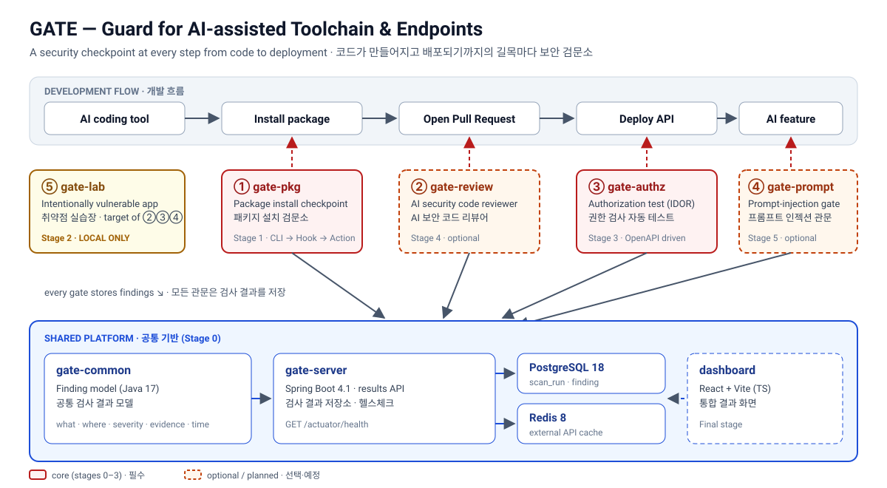
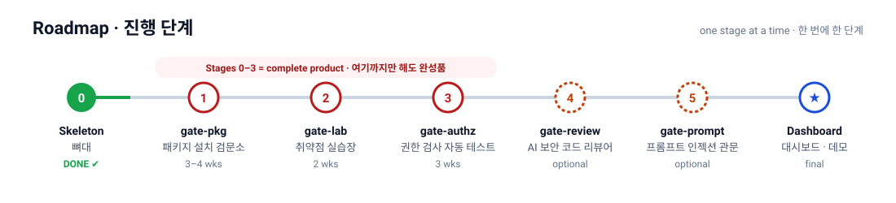
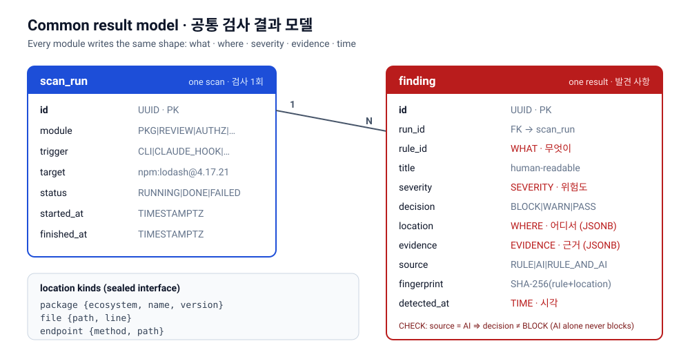

# GATE

**Guard for AI-assisted Toolchain & Endpoints**
AI 보조 개발 도구와 서비스 접점을 지키는 관문

[English](#english) · [한국어](#한국어) · [Progress / 진행 상황](docs/progress.md)



---

## English

### What is GATE?
GATE puts a **security checkpoint at every step from writing code to deploying it**.
Its focus is the new class of risks introduced by **AI coding tools** (Claude Code and similar): hallucinated package names, typosquatted dependencies, insecure generated code, missing authorization checks, and prompt injection into AI features.

### Modules
| # | Module | What it does | Stage |
|---|---|---|---|
| ① | `gate-pkg` | Checks packages **before install** — existence on the registry (hallucinated names), name similarity (typosquatting), publish age, install scripts, maintainer changes, downloads, known vulnerabilities (OSV). Ships as CLI → Claude Code hook → GitHub Action. | 1 |
| ⑤ | `gate-lab` | An **intentionally vulnerable** app (IDOR, SQL injection, missing JWT verification, verbose errors) plus a fixed version. Test target and demo. **Local only.** | 2 |
| ③ | `gate-authz` | Reads an OpenAPI spec and automatically tries to access user B's data with user A's token (IDOR / BOLA). | 3 |
| ② | `gate-review` | Combines static analysis with AI review on PR diffs. Measures detection / false-positive / false-negative rates. AI never decides alone. | 4 (optional) |
| ④ | `gate-prompt` | Inspects input and output in front of AI features; never executes model output as SQL, HTML or shell. | 5 (optional) |

Shared platform: a common result store (`gate-server`), a dashboard (React), GitHub Actions and Claude Code hook integrations.



### Common result model
Every module records findings in the same shape — **what** (rule), **where** (location), **severity**, **evidence**, **time** — so one dashboard can show them all.



Design rules enforced in both code (`gate-common`) and the database:
- A `BLOCK` or `WARN` finding must carry evidence.
- A finding produced by **AI alone cannot `BLOCK`**; a rule must back it.
- A fingerprint (`SHA-256(rule + location)`) de-duplicates the same finding.

### Tech stack
| Area | Choice |
|---|---|
| Backend | Java 17, Spring Boot 4.1.2, Gradle 9.8.2 (wrapper, checksum-pinned) |
| Storage | PostgreSQL 18.6 (results), Redis 8.8 (external API cache), Flyway migrations |
| Frontend | React + Vite (TypeScript) — final stage |
| Runtime | Docker Compose; all images pinned by tag **and digest** |
| Tests | JUnit 5, Testcontainers |

### Repository layout
```
GATE/
├─ gate-common/   shared Finding model (pure Java)
├─ gate-server/   Spring Boot API: result store, health check, Flyway schema
├─ docs/          progress log, ADRs, diagrams
└─ docker-compose.yml
```
Later stages add `gate-pkg/`, `gate-lab/`, `gate-authz/`, `gate-review/`, `gate-prompt/`, `dashboard/`.

### Getting started
Requirements: Docker Desktop (with Compose v2), JDK 17 for local builds.

```bash
cp .env.example .env        # then set GATE_DB_PASSWORD
docker compose up -d --build
curl http://localhost:8080/actuator/health
```
Expected: `{"status":"UP","components":{"db":{"status":"UP"},...,"redis":{"status":"UP"}}}`.
All ports bind to `127.0.0.1` only.

Build and test without Docker:
```bash
./gradlew build
```
Integration tests (`HealthCheckIT`) start real PostgreSQL and Redis containers and are skipped automatically when Docker is not available.

### Security principles of this repo
- No secrets in code, docs or commits. `.env` is git-ignored; `.env.example` holds key names only.
- New dependencies are checked (name, maintainer, downloads) before they are added — this project must not create the problem it guards against.
- Base images and GitHub Actions are pinned.
- `gate-lab` is **never deployed publicly**.

### Status
**Stage 0 (skeleton)** is built; the `docker compose up` health check still needs to be run on a machine with Docker. See [docs/progress.md](docs/progress.md).

### License
[MIT](LICENSE)

---

## 한국어

### GATE란?
GATE는 **코드가 만들어지고 배포되기까지의 길목마다 보안 검문소**를 둡니다.
특히 **AI 코딩 도구**(Claude Code 등)가 새로 만드는 위험을 막는 데 집중합니다. AI가 지어낸 패키지 이름, 철자를 흉내 낸 악성 패키지, 안전하지 않은 생성 코드, 권한 검사 누락, AI 기능에 대한 프롬프트 인젝션이 대상입니다.

### 모듈 구성
| 번호 | 모듈 | 하는 일 | 단계 |
|---|---|---|---|
| ① | `gate-pkg` | **설치 전에** 패키지 검사: 레지스트리 존재 여부(AI가 지어낸 이름), 이름 유사도(철자 흉내), 게시 시점, 설치 스크립트, 관리자 변경, 다운로드 수, 알려진 취약점(OSV). 명령줄 도구 → Claude Code 훅 → GitHub Action 순서로 제공 | 1 |
| ⑤ | `gate-lab` | **일부러 뚫어 둔** 앱(IDOR, SQL 인젝션, JWT 검증 누락, 에러 메시지 노출)과 고친 버전. 시험 대상이자 데모. **로컬 전용** | 2 |
| ③ | `gate-authz` | OpenAPI 명세를 읽고 사용자 A의 토큰으로 사용자 B의 데이터 접근을 자동으로 시도(IDOR/BOLA) | 3 |
| ② | `gate-review` | PR 변경분을 정적 분석 + AI로 검토. 검출·오탐·미탐 수치 측정. AI 단독 판정 금지 | 4 (선택) |
| ④ | `gate-prompt` | AI 기능 앞단에서 입력·출력 검사. AI 출력을 SQL·HTML·명령어로 바로 실행하지 않음 | 5 (선택) |

공통 부분: 검사 결과 저장소(`gate-server`), 대시보드(React), GitHub Actions 연동, Claude Code 훅 연동

### 공통 검사 결과 모델
모든 모듈은 같은 모양으로 결과를 남깁니다. **무엇이**(규칙), **어디서**(위치), **위험도**, **근거**, **시각**입니다. 그래서 대시보드 하나로 모든 결과를 볼 수 있습니다.

코드(`gate-common`)와 DB 양쪽에서 강제하는 규칙:
- `BLOCK`·`WARN` 판정에는 반드시 근거가 있어야 합니다.
- **AI 단독 판단으로는 `BLOCK`할 수 없습니다.** 규칙이 뒷받침해야 합니다.
- 지문(`SHA-256(규칙 + 위치)`)으로 같은 발견의 중복 저장을 막습니다.

### 기술 스택
| 영역 | 선택 |
|---|---|
| 백엔드 | Java 17, Spring Boot 4.1.2, Gradle 9.8.2 (wrapper, 체크섬 고정) |
| 저장소 | PostgreSQL 18.6 (검사 결과), Redis 8.8 (외부 API 캐시), Flyway 마이그레이션 |
| 프론트 | React + Vite (TypeScript), 마지막 단계 |
| 실행 | Docker Compose, 모든 이미지는 태그 **+ digest**로 고정 |
| 테스트 | JUnit 5, Testcontainers |

### 실행 방법
준비물: Docker Desktop(Compose v2), 로컬 빌드용 JDK 17

```bash
cp .env.example .env        # GATE_DB_PASSWORD 값을 채운다
docker compose up -d --build
curl http://localhost:8080/actuator/health
```
기대 결과: `status`가 `UP`이고 `db`, `redis` 모두 `UP`. 모든 포트는 `127.0.0.1`에만 열립니다.

Docker 없이 빌드·테스트:
```bash
./gradlew build
```
통합 테스트(`HealthCheckIT`)는 실제 PostgreSQL·Redis 컨테이너를 띄우며, Docker가 없으면 자동으로 건너뜁니다.

### 이 저장소의 보안 원칙
- 비밀값(API 키, 토큰, DB 비밀번호, 서버 주소)을 코드·문서·커밋에 넣지 않습니다. `.env`는 Git에서 제외합니다.
- 외부 라이브러리는 추가 전에 이름·관리자·다운로드 수를 확인합니다. 이 프로젝트가 막으려는 문제를 스스로 만들지 않습니다.
- 베이스 이미지와 GitHub Actions 버전은 고정합니다.
- `gate-lab`(취약한 앱)은 **절대 외부에 공개 배포하지 않습니다.**

### 진행 상황
**0단계(뼈대)** 코드 작성 완료. Docker가 있는 환경에서 `docker compose up` 헬스체크 확인이 남아 있습니다. 자세한 결정·이유·막힌 것·다음 할 일은 [docs/progress.md](docs/progress.md)에 있습니다.

### 라이선스
[MIT](LICENSE)
