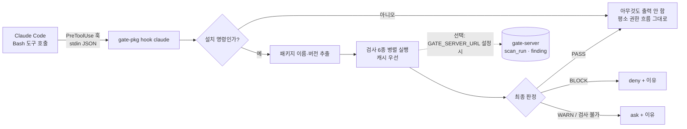

# 1단계 설계안: ① gate-pkg 패키지 설치 검문소

- 상태: **승인 (2026-11-09) · 구현 완료 (2026-11-09)**. "결정 필요" 4개 항목은 모두 제안대로 확정. 측정 후 조정한 내용은 [측정 보고서](../measurements/pkg-typo-fp.md)와 `docs/progress.md` 참고
- 작성일: 2026-11-08
- 확정된 전제: 순수 Java CLI jar · npm + PyPI · 검사 불가 시 "확인 요청"

## 1. 목표와 범위

**목표:** AI 코딩 도구가 패키지를 설치하려 할 때, 설치 **전에** 위험한 패키지를 찾아 막는다.

| 포함 | 제외 (이후 단계 또는 범위 밖) |
|---|---|
| 설치 명령에 **이름이 직접 적힌** 패키지 검사 | 인자 없는 `npm install`(package.json 전체), `pip install -r requirements.txt` → 1단계에서는 "확인 요청"만 한다 |
| npm: `npm install/i/add`, `yarn add`, `pnpm add` | 전이 의존성(설치되는 패키지의 의존성) 검사 |
| PyPI: `pip/pip3 install`, `python -m pip install`, `uv add`, `uv pip install`, `poetry add` | 패키지 코드 내용 분석(난독화·악성 코드 탐지) |
| PR에서 `package.json`·`requirements.txt`에 **새로 추가·변경된** 의존성 검사 (GitHub Action) | Maven, Go, Cargo 등 다른 레지스트리 |

경쟁 도구(Socket, Snyk 등)와 겹치는 "패키지 평판 DB"는 만들지 않는다. 차별점은 **AI 코딩 도구가 설치 명령을 실행하기 직전에 끼어드는 것**이다.

## 2. 전체 흐름



**PASS일 때 `allow`를 내지 않는다.** `allow`는 사용자의 기존 권한 설정을 건너뛰게 만들기 때문이다. 검문소는 막거나 묻기만 하고, 허락은 사용자의 권한 설정에 맡긴다.

## 3. 모듈 구조

```
gate-pkg/
├─ build.gradle.kts            # 실행 가능한 단일 jar (gate-pkg.jar), 의존성: gate-common + Jackson
├─ src/main/java/io/gate/pkg/
│  ├─ cli/          GatePkgCli (check · hook · diff 명령)
│  ├─ command/      설치 명령 파서 (npm·yarn·pnpm·pip·uv·poetry)
│  ├─ registry/     NpmRegistry, PyPiRegistry, OsvClient (java.net.http)
│  ├─ check/        검사 6종 + 조합 규칙 + 최종 판정
│  ├─ cache/        파일 캐시 (~/.gate/cache, TTL)
│  ├─ hook/         Claude Code 훅 입출력
│  └─ report/       gate-server 전송 (선택)
├─ src/main/resources/popular/
│  ├─ npm.txt       인기 패키지 상위 5,000 (철자 흉내 비교 기준)
│  └─ pypi.txt      인기 패키지 상위 5,000
└─ src/test/resources/fixtures/   레지스트리 응답 녹화본 (테스트는 네트워크를 쓰지 않는다)
.github/actions/gate-pkg/action.yml   # 복합 Action (PR 의존성 검사)
```

- CLI 인자 파싱은 직접 구현한다 (명령 3개뿐이라 picocli를 추가하지 않는다)
- 새 외부 라이브러리는 **Jackson 하나**이고, Spring Boot BOM으로 버전을 고정한다

## 4. 검사 규칙

모든 결과는 0단계 공통 모델(`Finding`)로 낸다. 위치는 `package{ecosystem, name, version}`이다.

| 규칙 ID | 검사 | 데이터 출처 | 판정 |
|---|---|---|---|
| `PKG-EXIST` | 레지스트리에 패키지가 없음 → **AI가 지어낸 이름 의심** | npm `GET /{name}` 404, PyPI `GET /pypi/{name}/json` 404 | **BLOCK · CRITICAL** |
| `PKG-EXIST` | 패키지는 있지만 요청한 버전이 없음 | 같은 응답의 `versions` / `releases` | **BLOCK · HIGH** |
| `PKG-TYPO` | 인기 패키지와 철자가 비슷함 (아래 4.1) | 인기 목록 스냅샷 + 다운로드 수 | 아래 4.1 |
| `PKG-NEW` | 첫 게시 후 7일 미만 | npm `time.created`, PyPI 첫 릴리스 업로드 시각 | WARN · MEDIUM |
| `PKG-NEW` | 요청한 버전이 게시 후 24시간 미만 | npm `time[version]`, PyPI 릴리스 업로드 시각 | WARN · MEDIUM |
| `PKG-SCRIPT` | npm: 요청 버전에 `preinstall`·`install`·`postinstall` 스크립트 있음 | npm 버전 문서 `scripts` | WARN · MEDIUM |
| `PKG-SCRIPT` | PyPI: wheel 없이 sdist만 있음 (설치 시 `setup.py` 실행 가능) | PyPI `urls[].packagetype` | WARN · LOW |
| `PKG-MAINT` | npm: 요청 버전의 게시자(`_npmUser`)가 직전 버전 게시자·관리자 목록에 없음 → **계정 탈취 패턴** | npm 버전 문서 | WARN · HIGH |
| `PKG-MAINT` | PyPI: 게시자 이력을 API로 얻을 수 없음 | — | 1단계에서는 검사하지 않음 (문서에 한계로 명시) |
| `PKG-POP` | 주간 다운로드 100 미만 | `api.npmjs.org/downloads/point/last-week`, `pypistats.org/api/packages/{name}/recent` | WARN · LOW |
| `PKG-VULN` | OSV에서 `MAL-` ID(악성 패키지 보고) 발견 | `POST api.osv.dev/v1/query` | **BLOCK · CRITICAL** |
| `PKG-VULN` | 알려진 취약점: CRITICAL | 같은 API | **BLOCK · CRITICAL** |
| `PKG-VULN` | 알려진 취약점: HIGH 이하 | 같은 API | WARN (심각도 그대로) |
| `PKG-COMBO` | `PKG-NEW` + (`PKG-SCRIPT` 또는 `PKG-POP`) 동시 해당 | 위 결과 조합 | **BLOCK · HIGH** |
| `PKG-UNCHECKED` | 레지스트리·OSV 응답 없음, 시간 초과, 명령 해석 불가 | — | WARN · INFO → 훅에서는 **ask** |

**최종 판정**은 결과 중 가장 강한 것(BLOCK > WARN > PASS)으로 정한다. 버전을 적지 않으면 `latest`(npm `dist-tags.latest`, PyPI `info.version`)를 기준으로 검사한다.

### 4.1 철자 흉내 (`PKG-TYPO`)

1. 이름 정규화: 소문자 변환. PyPI는 PEP 503 규칙으로 `-`, `_`, `.`를 하나로 본다
2. 검사 대상이 인기 목록에 **있으면** 검사하지 않는다
3. 인기 목록과 비교해 아래 중 하나라도 맞으면 "비슷함"으로 본다
   - 편집 거리(Damerau-Levenshtein): 이름 5~9자는 1 이하, 10자 이상은 2 이하
   - 구분자만 다름: `react-dom` / `reactdom` / `react_dom`
   - 비슷하게 생긴 글자: `rn`↔`m`, `l`↔`1`↔`i`, `0`↔`o`
   - 접두·접미어 추가: `python-`, `py-`, `-js`, `node-`, `-dev`
   - npm 스코프 흉내: `@types/foo` ↔ `types-foo`
4. 판정
   - 비슷함 + (인기 패키지 다운로드의 1% 미만 **또는** 첫 게시 90일 미만) → **BLOCK · HIGH**
   - 비슷하지만 자체 사용자가 많음 → ~~WARN · LOW~~ **기록만(PASS · INFO)** (2026-11-09 측정 후 사용자 결정. 예: `progressbar`↔`progressbar2`)
   - 비율로 차단하려면 자기 주간 다운로드도 1만 미만이어야 한다 (2026-11-09 측정 후 추가)
5. 근거(evidence)에 "어떤 인기 패키지와 어떤 방식으로 비슷한지"를 남긴다

**인기 목록 스냅샷 출처** (저장소에 텍스트로 넣고, 헤더에 출처와 날짜를 적는다)
- npm: `npm-high-impact` 패키지의 데이터 (MIT, 관리자 wooorm)
- PyPI: `hugovk/top-pypi-packages` 30일 다운로드 상위 목록 (2026-11-01 기준 15,000개)
- 갱신 스크립트 `scripts/update-popular-lists.py`는 데이터 파일만 받는다. 패키지 코드는 설치하거나 실행하지 않는다

## 5. 제공 형태

### 5.1 CLI
```
java -jar gate-pkg.jar check npm lodash@4.17.21 express
java -jar gate-pkg.jar check pypi requests==2.32.3 --format json
java -jar gate-pkg.jar hook claude          # stdin: 훅 JSON / stdout: 훅 응답 JSON
java -jar gate-pkg.jar diff --base <ref> --head <ref>   # PR용: 매니페스트에서 추가·변경된 의존성만 검사
```
| 종료 코드 | 의미 |
|---|---|
| 0 | PASS |
| 1 | WARN |
| 2 | BLOCK |
| 3 | 검사 불가 (네트워크·입력 오류) |

### 5.2 Claude Code 훅
사용자 프로젝트의 `.claude/settings.json`에 넣는다.
```json
{
  "hooks": {
    "PreToolUse": [
      {
        "matcher": "Bash",
        "hooks": [{ "type": "command", "command": "gate-pkg hook claude", "timeout": 30 }]
      }
    ]
  }
}
```
- `tool_input.command`를 `&&`, `||`, `;`, `|` 기준으로 나눠서 조각마다 설치 명령인지 본다
- BLOCK이면 `permissionDecision: "deny"`, WARN이나 검사 불가면 `"ask"`를 낸다. 이유(`permissionDecisionReason`)에는 규칙 ID와 근거를 한 줄씩 적는다
  - Claude는 deny 이유를 읽고 다른 패키지를 찾게 된다
- `gate-pkg`·`gate-pkg.cmd` 래퍼 스크립트로 `java -jar` 경로를 감춘다

### 5.3 GitHub Action
`.github/actions/gate-pkg` 복합 Action이다.
1. PR의 base와 head에서 `package.json`, `requirements.txt`, `pyproject.toml`을 비교해 추가·변경된 의존성을 뽑는다
2. 결과를 Job Summary 표로 남긴다
3. BLOCK이 있으면 실패하고, WARN은 주석(annotation)으로 남긴다

## 6. 캐시와 성능

외부 API 요청 제한에 대비해 결과를 `~/.gate/cache`에 파일로 저장한다(`GATE_CACHE_DIR`로 변경 가능). 캐시 키는 SHA-256으로 만든다.

| 대상 | TTL | 이유 |
|---|---|---|
| 패키지 메타데이터 | 1시간 | 새 버전 게시를 너무 늦게 반영하지 않기 위해 |
| 다운로드 수 | 24시간 | 하루 단위 집계 |
| OSV 결과 | 6시간 | 신규 악성 보고를 하루 안에 반영 |
| **"존재하지 않음"(404)** | **10분** | 공격자가 AI가 지어낸 이름을 뒤늦게 선점할 수 있으므로 짧게 둔다 |

- 패키지마다 요청을 비동기로 병렬 실행한다. 요청 하나의 제한 시간은 3초다
- 목표 시간: 패키지 1개 기준 캐시 없음 2초 이내(p95), 캐시 있음 0.5초 이내
- Redis는 1단계에서 쓰지 않는다. CLI가 서버 없이도 동작해야 하기 때문이다. 서버 쪽에서 검사를 돌리게 될 때 Redis를 쓴다

## 7. 결과 저장 (gate-server, 선택 전송)

- `GATE_SERVER_URL`이 설정되어 있을 때만 CLI가 결과를 보낸다 (제한 시간 1초). 실패해도 판정에는 영향이 없다
- 새 API: `POST /api/scan-runs` 요청 하나에 scan_run과 findings를 함께 보내고, 응답은 `201`이다
  - 입력은 `gate-common` 모델 규칙으로 검증한다. 근거 없는 BLOCK이나 AI 단독 BLOCK은 400으로 거부한다
  - 인증: 1단계에서는 서버가 `127.0.0.1`에만 열려 있어서 넣지 않는다. 외부에 노출하는 단계에서 토큰을 추가한다 (문서에 한계로 명시)
- 조회 API(`GET`)는 대시보드 단계에서 만든다

## 8. 이 도구 자체의 안전 원칙

- 패키지를 **설치하거나 실행하지 않는다.** 레지스트리 메타데이터(JSON)만 읽는다
- `npm`·`pip` 명령을 직접 실행하지 않는다
- 명령 파싱은 보수적으로 한다. 해석할 수 없는 설치 명령(변수 치환 `$(...)`, `eval` 등)은 통과시키지 않고 **ask**로 처리한다
- 오탐 예외 처리: 프로젝트의 `.gate/pkg-allow.txt`에 `ecosystem:name@version  # 이유` 형식으로 적는다. 버전을 반드시 적어야 하고, 예외로 처리한 결과도 PASS가 아닌 INFO로 기록한다

## 9. 테스트 계획 (완료 기준: "각 검사 항목에 테스트 있음")

| 대상 | 방법 |
|---|---|
| 검사 6종 + 조합 규칙 | 레지스트리 응답 녹화본(fixture)으로 단위 테스트. 규칙마다 해당 케이스와 비해당 케이스를 하나씩 둔다 |
| 철자 흉내 | `lodahs`, `reqeusts`, `react_dom`, `types-node`(↔`@types/node`)는 걸리고, `preact`, `lodash`는 통과해야 한다 |
| 명령 파서 | 설치 명령 형태별 표 기반 테스트 (`npm i -D a@1 b`, `pip install "x[extra]>=1"`, `cd app && npm i x` 등) |
| 훅 계약 | stdin JSON을 넣고 stdout JSON을 비교한다 (deny / ask / 출력 없음) |
| 캐시 | TTL 만료, 404의 짧은 TTL |
| 실제 네트워크 | `liveTest` 태스크로 따로 둔다. 기본 빌드와 CI의 PR 검사에서는 돌리지 않고, 주 1회 예약 실행한다 |

**완료 기준 데모** (README에 화면 녹화 또는 스크린샷으로 첨부)
1. Claude Code에 "`lodahs` 설치해 줘"라고 요청하면 훅이 `PKG-TYPO`로 막는다
2. 존재하지 않는 이름(예: AI가 만든 그럴듯한 이름)을 요청하면 `PKG-EXIST`로 막는다
3. `npm install lodash`, `pip install requests`는 아무 개입 없이 진행된다

## 10. 일정 (3~4주)

| 주차 | 할 일 |
|---|---|
| 1주 | 모듈 뼈대, npm 클라이언트, `PKG-EXIST`·`PKG-NEW`·`PKG-SCRIPT`·`PKG-POP`, 파일 캐시 |
| 2주 | PyPI 클라이언트, `PKG-TYPO`(인기 목록 포함), `PKG-VULN`(OSV), `PKG-MAINT`, `PKG-COMBO` |
| 3주 | 명령 파서, `check`·`hook` 명령, 래퍼 스크립트, 훅 데모 |
| 4주 | `diff` 명령과 GitHub Action, gate-server 저장 API, 문서와 측정(검사 시간) |

## 11. 확정된 결정 (2026-11-09, 모두 제안대로)

1. 임계값: 신규 7일 / 버전 24시간 / 주간 다운로드 100 / 철자 흉내 1%·90일로 시작하고, 실제 사용 후 조정한다
2. OSV HIGH 취약점은 WARN, CRITICAL과 `MAL-`은 BLOCK
3. 오탐 예외 파일 `.gate/pkg-allow.txt`를 1단계에 포함한다
4. 3주차부터 GATE 저장소 자체에 훅을 적용한다(dogfooding)
