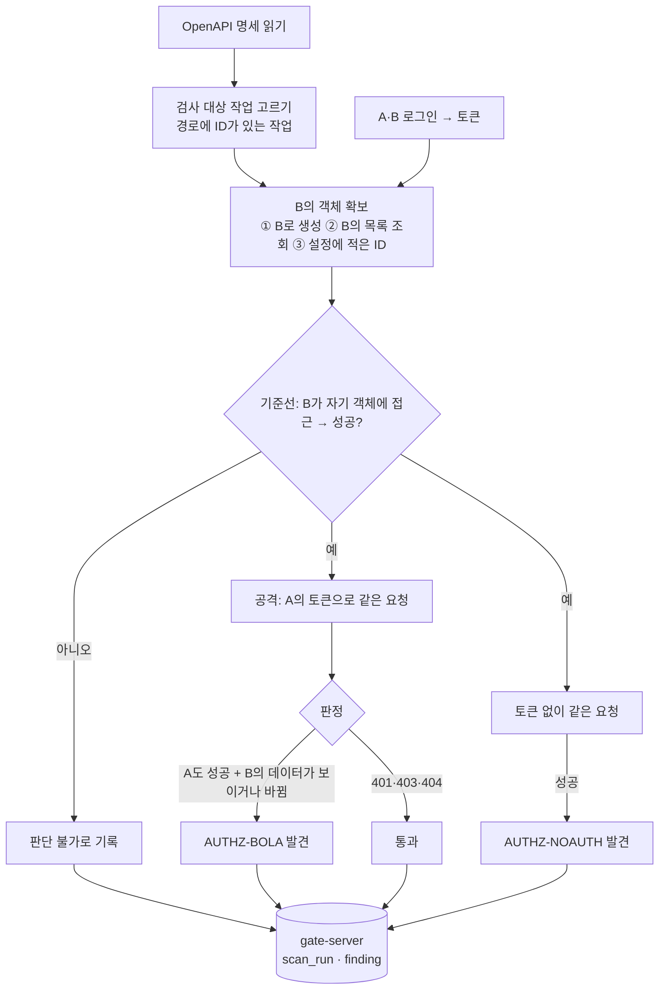

# 3단계 설계안: ③ gate-authz 권한 검사 자동 테스트

- 상태: **승인·착수 (2026-11-09)**. "결정 필요" 4개 항목 모두 추천안으로 확정 (7장). 1·2주차 완료
- 작성일: 2026-11-09

## 1. 목표와 범위

**목표:** API 명세(OpenAPI)를 읽고, **사용자 A의 토큰으로 사용자 B의 데이터에 접근하는 시도를 자동으로** 해 본다(IDOR/BOLA). 결과는 공통 검사 결과 저장소에 남긴다.

**완료 기준 (계획서):** 실습장의 뚫린 버전에서 IDOR를 찾고, 고친 버전에서는 찾지 않는다.

| 포함 | 제외 (이후 또는 범위 밖) |
|---|---|
| 객체 단위 권한(BOLA): 경로에 객체 ID가 있는 작업(`/api/orders/{id}`)을 A의 토큰으로 B의 객체에 실행 | 기능 단위 권한(BFLA, 일반 사용자가 관리자 기능 호출). 실습장에 관리자 기능이 없어 이후로 미룬다 |
| 인증 누락: 같은 요청을 토큰 없이 보냈을 때 통과하는지 | 토큰 위조(V3 같은 서명 검증 누락)는 인증 검사 영역. 이후 단계 후보 |
| 조회(GET)와, 허용했을 때만 수정(PUT·PATCH)·삭제(DELETE) | 대량 할당(mass assignment), 속도 제한 등 다른 API 취약점 |
| OpenAPI 3.0 JSON·YAML | GraphQL, gRPC |

경쟁 도구(OWASP ZAP, Burp 확장 등)와 겹치는 "범용 스캐너"는 만들지 않는다. 차별점은 **AI가 새로 만든 API를 사람 손 없이 바로 권한 검사하는 것**이다. 명세만 있으면 설정 몇 줄로 돌고, 결과가 gate-pkg와 같은 공통 모델로 남는다.

## 2. 동작 흐름



### 2.1 판정 규칙
| 규칙 ID | 시도 | 발견으로 보는 조건 | 위험도·판정 |
|---|---|---|---|
| `AUTHZ-BOLA-READ` | A가 B의 객체 `GET` | 2xx이고, 응답이 B의 기준선 응답과 같은 객체(같은 `id`, 소유자 필드가 B 등)를 담음 | HIGH · BLOCK |
| `AUTHZ-BOLA-WRITE` | A가 B의 객체 `PUT`·`PATCH` | 2xx이고, **B가 다시 읽었을 때 값이 바뀌어 있음** (응답 코드만 믿지 않음) | CRITICAL · BLOCK |
| `AUTHZ-BOLA-DELETE` | A가 B의 객체 `DELETE` | 2xx이고, **B가 다시 읽었을 때 사라져 있음** | CRITICAL · BLOCK |
| `AUTHZ-NOAUTH` | 토큰 없이 B의 객체 접근 | 2xx (명세가 인증 필요로 표시한 작업만) | HIGH · BLOCK |
| `AUTHZ-INCONCLUSIVE` | — | 기준선 실패, B의 객체를 못 만듦, 5xx 등 | INFO · WARN (판단 불가를 숨기지 않음) |

- **"응답 코드만으로 판정하지 않는다."** 200을 주면서 실제로는 아무것도 안 하는 API도 있으므로, 쓰기·삭제는 B가 다시 읽어 확인한다(2단계의 "공격이 실제로 닿는지 함께 확인" 교훈)
- 403과 404는 모두 "막힘"으로 본다. 다만 403은 객체 존재를 드러낸다는 정보 노출 메모를 근거에 남긴다(판정은 통과)

### 2.2 B의 객체 확보
1. **B로 생성**: 같은 자원의 생성 작업(`POST /api/orders`)을 찾아 B로 호출하고 응답의 `id`를 쓴다. 본문은 명세의 `example` 값, 없으면 스키마 형식에서 만든 최소값
2. **B의 목록 조회**: 목록 작업(`GET /api/orders`)의 응답에서 `id`를 고른다
3. **설정에 적은 ID**: 위 둘로 못 찾을 때 사람이 적어 준다

자원 이름은 경로로 묶는다: `/api/orders/{id}` ↔ `/api/orders`.

## 3. 안전장치 (남의 시스템 공격 도구가 되지 않게)

| 장치 | 내용 |
|---|---|
| 대상 허용 목록 | 기본은 루프백(127.0.0.1, ::1, localhost)만. 그 밖의 호스트는 설정의 `allowedHosts`에 **이름을 명시**해야 실행. 명세의 `servers`에 적힌 주소를 그대로 믿지 않는다 |
| 쓰기·삭제는 따로 허용 | 기본은 조회(GET)만. 수정·삭제는 `allowMutation: true`일 때만, 그리고 **테스트가 직접 만든 B의 객체에만** 실행. 기존 데이터는 건드리지 않는다 |
| 요청 수 제한 | 초당 요청 수 상한(기본 5), 작업당 시도 수 상한 |
| 비밀값 | 비밀번호는 환경 변수로만 받는다. 토큰·비밀번호·`Authorization` 헤더는 결과·로그에 남기지 않는다(마스킹) |
| 근거 축약 | 응답 본문은 앞부분만, 개인정보처럼 보이는 필드는 가려서 저장 |

## 4. 제공 형태와 설정

```
gate-authz/
├─ src/main/java/io/gate/authz/
│  ├─ spec/     OpenAPI 읽기 (경로·메서드·파라미터·요청 본문 스키마·보안 요구)
│  ├─ auth/     로그인해서 토큰 받기
│  ├─ probe/    객체 확보, 기준선, 공격, 판정
│  ├─ cli/      gate-authz scan
│  └─ report/   결과 출력·gate-server 전송 (gate-pkg와 같은 방식)
└─ src/test/... 실습장(gate-lab)을 테스트 안에서 직접 띄워 두 버전을 검사 (Docker 불필요)
```

설정 파일 예 (`gate-authz.yml`):
```yaml
spec: http://127.0.0.1:8081/openapi.yaml
baseUrl: http://127.0.0.1:8081
login:
  path: /api/auth/login
  body: { username: "{username}", password: "{password}" }
  tokenField: accessToken
users:
  a: { username: alice, passwordEnv: GATE_AUTHZ_PASSWORD_A }
  b: { username: bob,   passwordEnv: GATE_AUTHZ_PASSWORD_B }
allowMutation: true      # 기본 false
allowedHosts: []         # 루프백은 기본 허용
```

```bash
gate-authz scan --config gate-authz.yml --format text|json    # 종료 코드: 0 통과, 2 발견, 3 판단 불가
```

## 5. 테스트 계획
| 대상 | 방법 |
|---|---|
| 명세 읽기·작업 고르기·자원 묶기 | 실습장 `openapi.yaml`과 작은 예제 명세로 단위 테스트 |
| 판정 규칙 | 가짜 HTTP 응답으로 규칙마다 해당·비해당 |
| 안전장치 | 허용되지 않은 호스트 거부, `allowMutation` 없이 쓰기 시도 안 함, 토큰 마스킹 |
| **완료 기준** | 테스트 안에서 gate-lab을 `vulnerable`·`fixed`로 띄워 검사: **vulnerable에서 `AUTHZ-BOLA-READ`·`WRITE`·`DELETE` 발견, fixed에서는 0건** |
| CI | compose-smoke 잡에서 실습장 컨테이너를 대상으로 같은 검사(실제 네트워크 경로) |

## 6. 일정 (3주)
| 주차 | 할 일 |
|---|---|
| 1주 | 모듈 뼈대, OpenAPI 읽기, 로그인, 객체 확보, 조회(GET) BOLA·인증 누락 검사, 안전장치 |
| 2주 | 수정·삭제 검사(다시 읽어 확인), 판단 불가 처리, CLI·설정 파일, 결과 출력·서버 전송 |
| 3주 | 실습장 두 버전 대상 완료 기준 테스트, CI 연동, 문서·데모 |

## 7. 확정된 결정 (2026-11-09)
| # | 항목 | 결정 | 이유 |
|---|---|---|---|
| 1 | 자격 증명 | **설정에 로그인 방법**, 비밀번호는 환경 변수로만 | 검사마다 새 토큰을 받아 만료 문제가 없고, 비밀값이 설정 파일·저장소에 남지 않는다 |
| 2 | 수정·삭제 시도 | **명시 허용(`allowMutation: true`) 시에만**, 테스트가 직접 만든 B의 객체에만 | 기본은 조회만 해서 안전하고, 실습장의 수정·삭제 IDOR도 찾을 수 있다 |
| 3 | 실행 형태 | **독립 Java CLI** (gate-pkg와 같은 방식, 결과는 gate-server로 선택 전송) | 서버가 임의 주소로 요청을 보내는 구조(SSRF 위험)를 피한다 |
| 4 | 검사 범위 | **BOLA + 인증 누락** | 계획서 완료 기준에 맞추고 3주 안에 끝낸다. BFLA는 이후 단계 후보 |
