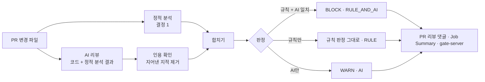

# 4단계 설계안: ② gate-review AI 보안 코드 리뷰어 (선택 단계)

- 상태: **승인·착수 (2026-11-13)**. "결정 필요" 4개 항목 모두 추천안으로 확정 (8장). 1~3주차 구현 완료. 정적 분석 측정 완료, AI 측정은 사용자 API 키 대기
- 작성일: 2026-11-09

## 1. 목표와 원칙

**목표:** PR 변경분을 정적 분석과 AI로 함께 검토해 보안 문제를 지적하고, **실습장 코드로 검출·오탐·미탐 수치를 재서 문서로 남긴다.**

**완료 기준 (계획서):** 실습장의 취약 코드 PR에서 지적이 달리고, 측정 수치가 문서화됨.

| 원칙 | 구현 방법 |
|---|---|
| **AI 판단만으로 합격·불합격을 내리지 않는다** | 공통 모델이 이미 강제한다: AI 단독 결과(`source=AI`)는 BLOCK 불가(코드 + DB 제약). 정적 분석 규칙과 AI가 **같은 위치·같은 종류**를 지적할 때만 `RULE_AND_AI`로 BLOCK. AI 단독은 WARN(사람이 보라는 표시) |
| **근거(코드 위치·규칙)를 함께 낸다** | 모든 결과에 파일·줄·CWE·근거 문장·**문제 코드 인용**을 필수로 받는다(구조화 출력 스키마) |
| **AI가 지어낸 지적은 버린다** | AI가 인용한 코드가 그 줄에 실제로 있는지 확인하고, 없으면 버린다(버린 수도 측정에 기록) |
| **검토 대상 코드는 데이터다** | 코드 안의 "이전 지시를 무시하라" 같은 문장은 지시가 아니라 검토 대상이다. 코드를 구분 태그 안에 넣고, 시스템 프롬프트에 그 사실을 명시한다(5단계 프롬프트 인젝션 주제와 이어짐) |
| 경쟁 도구와의 차이 | Semgrep·CodeQL 같은 정적 분석만으로는 찾기 어려운 **권한 확인 누락(IDOR)·서명 검증 누락** 같은 논리 결함을 AI가 보완하는지를 수치로 보여 준다. AI 코딩 도구가 만든 PR에 바로 붙는 것이 차별점 |

## 2. 흐름



### 2.1 AI 호출
| 항목 | 설계 |
|---|---|
| 방식 | **공식 Java SDK** (`com.anthropic:anthropic-java`, 버전은 구현 시점의 2주 이상 된 안정판으로 고정) |
| 모델 | 결정 2. 기본 권장은 Claude Opus 5.5 (`claude-opus-5-5`) |
| 출력 | **구조화 출력**(`output_config.format`, JSON 스키마): `findings[] = {file, line, endLine, cwe, title, severity, evidence, quotedCode, confidence}`. 형식이 틀리면 1회 재시도 후 "AI 결과 없음"으로 기록 |
| 추론 강도 | `effort`를 명시한다(Opus 5.5 기본값은 medium). 측정에서 medium·high를 비교해 정한다 |
| 캐싱 | 시스템 프롬프트(검토 지침 + 규칙 목록)를 고정해 프롬프트 캐싱. 변하는 코드는 그 뒤에 둔다 |
| 거절·오류 | `stop_reason`을 먼저 확인한다. 거절(refusal)·요청 제한·서버 오류는 "AI 검토 불가"로 남기고 정적 분석 결과만 낸다(통과로 처리하지 않음) |
| 비밀값 | `ANTHROPIC_API_KEY`는 환경 변수·GitHub Secret으로만. 포크에서 온 PR에는 Secret이 전달되지 않으므로 그때는 정적 분석만 하고 그 사실을 표시한다 |

### 2.2 범위
- 대상: PR에서 바뀐 `.java` 파일 전체(변경 줄만이 아니라 파일 단위. 권한 확인 누락은 주변 맥락이 있어야 보인다). 파일 수·크기 상한을 두고 넘으면 나눠 보낸다(잘라 내지 않음)
- 제외: 테스트 코드, 생성 코드

## 3. 측정 설계 (계획서 요구: 검출·오탐·미탐 수치)

| 항목 | 내용 |
|---|---|
| 정답지 | 2단계에서 만든 `docs/lab/ground-truth.json` (취약점 4개의 파일·줄 범위·CWE, 깨끗해야 할 파일 5개) |
| **경로 중립화** | 리뷰어에게 줄 때 `vulnerable`·`fixed` 패키지·`@Profile` 이름을 중립 이름(예: `variant_a`)으로 바꾼 복사본을 쓴다. 줄 수는 바꾸지 않아 정답지 줄 번호가 그대로 유효하다 (2단계에서 남긴 숙제) |
| 검출(TP) | 정답 취약점의 파일·줄 범위 안을 가리키고, CWE 계열이 맞는 지적 |
| 미탐(FN) | 어떤 지적도 맞히지 못한 정답 취약점 |
| 오탐(FP) | 깨끗해야 할 파일(고친 버전)에 대한 지적, 그리고 정답 범위 밖 지적 |
| 비교 대상 | ① 정적 분석만 ② AI만 ③ 합친 결과(BLOCK 기준·WARN 포함 기준 각각) |
| 반복 | AI는 같은 입력에도 결과가 달라질 수 있어 **3회 실행**해 평균과 범위를 남긴다 |
| 추가 기록 | 지어낸 지적으로 버린 수, 호출당 토큰·비용·시간 |
| 결과 | `docs/measurements/review-accuracy.md` + 원자료 JSON (1단계 측정과 같은 방식) |

예상(가설): 정적 분석은 V2(SQL 인젝션)를 잡고 V1(IDOR)·V3(JWT)은 놓친다. AI가 V1·V3를 보완하는지가 측정의 핵심이다. 가설이 틀려도 그대로 기록한다.

## 4. PR 데모

- PR 워크플로 `gate-review.yml`: 변경 파일 검토 → **PR 리뷰 댓글(해당 줄)**, Job Summary, 결과 gate-server 전송(선택). 권한은 `pull-requests: write`만
- 데모 PR: 고친 버전 코드에 취약 패턴을 다시 넣는 브랜치(예: 주문 조회에서 주인 확인 제거). 결정 4
- CI의 일반 푸시 검사에서는 AI를 부르지 않는다(비용·비밀값). 정적 분석과 가짜 AI 응답으로 계약만 확인

## 5. 모듈 구조

```
gate-review/
├─ src/main/java/io/gate/review/
│  ├─ diff/       PR 변경 파일 읽기 (gate-pkg의 GitReader 방식 재사용)
│  ├─ staticscan/ 정적 분석 실행·결과 읽기 (결정 1)
│  ├─ ai/         Claude 호출, 구조화 출력, 인용 확인
│  ├─ merge/      합치기·판정 (RULE / AI / RULE_AND_AI)
│  ├─ measure/    정답지 대비 TP·FP·FN 계산, 경로 중립화
│  └─ cli/        gate-review review|measure
└─ src/test/...   가짜 AI 응답으로 판정·인용 확인·측정 계산 테스트 (API 키 없이 실행)
```

## 6. 비용 추정 (구현 시 `count_tokens`로 실측해 고친다)
- 한 번 검토: 실습장 Java 파일 약 12개 ≈ 입력 2만~3만 토큰, 출력(추론 포함) 약 5천~1만 토큰
- Claude Opus 5.5 기준 약 **$0.2~0.4 / 회**, Sonnet 5.5 약 $0.1~0.2, Haiku 5.5 약 $0.01 이하
- 측정 전체(AI 3회 × 추론 강도 2종 + 데모 PR 몇 번) ≈ **Opus 5.5 기준 $3~5**

## 7. 일정 (3주)
| 주차 | 할 일 |
|---|---|
| 1주 | 모듈 뼈대, 정적 분석 연동과 실습장 규칙, 판정·합치기, 가짜 AI로 테스트 |
| 2주 | Claude 호출(구조화 출력·캐싱·거절 처리), 인용 확인, 경로 중립화, CLI |
| 3주 | 측정 3회·문서화, PR 워크플로와 데모 PR, README |

## 8. 확정된 결정 (2026-11-09)
| # | 항목 | 결정 | 메모 |
|---|---|---|---|
| 1 | 정적 분석 | **Semgrep** | 실습장·Spring용 규칙을 저장소에 YAML로 둔다. 엔진 버전 고정, CI에서 실행 |
| 2 | AI 모델 | **Claude Opus 5.5** (`claude-opus-5-5`) | 입력 $4 / 출력 $20 (100만 토큰당). 추론 강도는 측정으로 정함 |
| 3 | API 키·예산 | **사용자가 키를 준비**(로컬 환경 변수 + GitHub Secret `ANTHROPIC_API_KEY`), **측정 예산 상한 $10** | 키는 사용자가 직접 넣는다(대화·코드·문서에 남기지 않음). 실제 호출 전에는 매번 예상 비용을 알리고 확인받는다 |
| 4 | 데모 PR | **실제 PR** | 데모 브랜치를 푸시하면 사용자가 GitHub에서 PR을 연다(이 PC에 gh 없음) |
